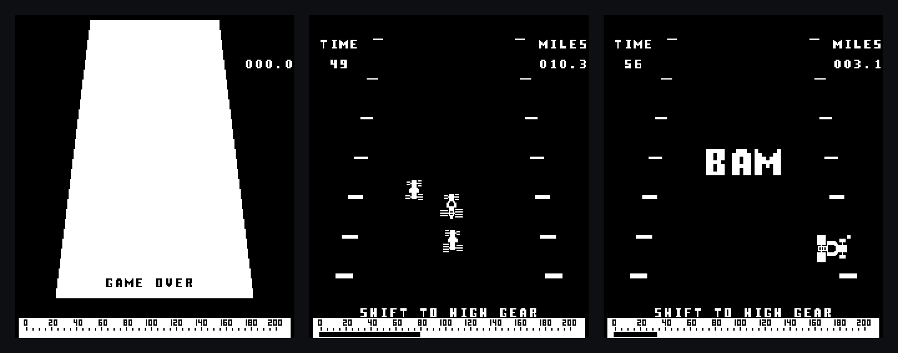
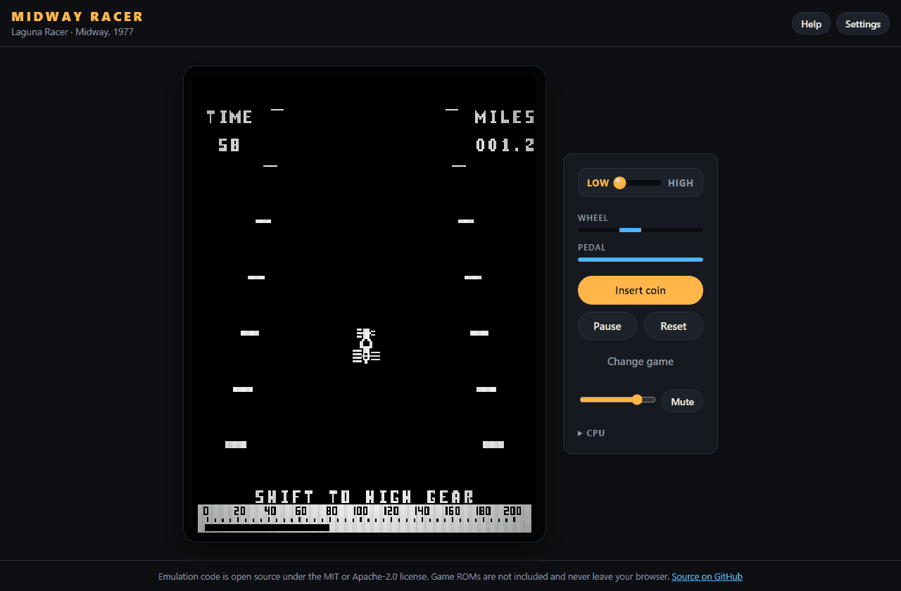

<p align="center">
  
</p>

# Midway Racer

[](https://github.com/fzn0x/midway-racer/actions/workflows/ci.yml)
[](https://github.com/fzn0x/midway-racer/actions/workflows/pages.yml)
[](#license)

A cycle-accurate Intel 8080 emulator of Midway's black-and-white arcade
board, running the 1970s racers **Laguna Racer** (1977) and **280-ZZZAP**
(1976), in the browser and on the desktop.

**Play it in your browser: <https://fzn0x.github.io/midway-racer/>**



*Laguna Racer as the emulator draws it: the attract mode, racing through
traffic, and steering into the roadside.*

The game ROMs are copyrighted and not included. Load your own dump, such
as MAME's `lagunar.zip`; it is checked against MAME's checksums and never
leaves your machine.



## Features

- **Verified with the original ROMs.** With MAME's `lagunar` set, Laguna
  Racer boots into its attract mode, takes coins, races, steers, shifts
  gear and crashes, without a single watchdog reset.
- **An exact 8080.** Every documented and undocumented opcode with its
  real timing. The core passes the classic CP/M diagnostics, `TST8080`,
  `8080PRE`, `CPUTEST` and the full `8080EXM` exerciser, with exactly the
  instruction and cycle counts other accurate emulators report (23.8
  billion cycles for `8080EXM`).
- **The board, timed like the hardware.** Frames of 33,536 cycles at
  59.54 Hz, run scan line by scan line; `RST 1` at line 96 and `RST 2` at
  line 224, gated by the CPU's INTE pin; the MB14241 barrel shifter; the
  1.1 s watchdog; and the 260-pixel raster with its four-pixel shift
  register delay. See [the hardware notes](docs/hardware.md).
- **The sound board.** Engine, tyre skid, crash boom and post-crash
  screech, modelled from the schematics: engine inertia, the high-gear
  pitch drop, the MC3340's chopped buzz and the ringing 60 Hz boom. Latch
  writes take effect at the exact sample they happen at.
- **Real controls.** A steering wheel and a 16-step accelerator, read like
  the cabinet's potentiometer and encoder, driven by keys, gamepad sticks
  and triggers, or a touch strip that steers like a wheel.
- **Faithful picture.** Laguna Racer's monitor turned on its side,
  280-ZZZAP's blue overlay, the monitor's 4:3 shape (or square pixels) and
  optional scanlines that follow the raster.
- **Friendly ROM handling.** Zip archives, loose dumps, folders or a
  single combined image; chips are recognised by checksum whatever their
  names, and every chip's status is reported.
- **Operator settings.** Every DIP switch with its real labels.
- **A CPU debugger** in the browser: registers, disassembly and
  frame-by-frame stepping.

## Playing

### Controls

| Action      | Keyboard              | Gamepad                    | Touch          |
| ----------- | --------------------- | -------------------------- | -------------- |
| Steer       | `←` `→` or `A` `D`    | Left stick, d-pad          | Drag the strip |
| Accelerate  | `↑` or `W`            | Right trigger, A           | Gas            |
| Shift gear  | `Space` or `Shift`    | X, or LB and RB for low/high | Gear         |
| Insert coin | `C` or `5`            | Back                       | Coin           |
| Start       | `1` or `Enter`        | Start                      |                |
| Pause       | `P`                   |                            |                |
| Reset       | `F3`                  |                            |                |
| Sound       | `M` mutes, `-` `=` set volume |                    |                |

In the browser, `H` shows the help, `` ` `` the CPU debugger, and `N` runs
one frame while paused.

### ROMs

| Game                | MAME set    | Files                                               |
| ------------------- | ----------- | --------------------------------------------------- |
| Laguna Racer        | `lagunar`   | `lagunar.h`, `lagunar.g`, `lagunar.f`, `lagunar.e`  |
| 280-ZZZAP           | `280zzzap`  | `zzzaph`, `zzzapg`, `zzzapf`, `zzzape`, `zzzapd`, `zzzapc` |
| 280-ZZZAP (set 2)   | `280zzzapa` | `h`, `g`, `f`                                       |

## Run it locally

You can run the desktop app, the browser version, or both. Each starts
from a clone of the repository.

### 1. Install the prerequisites

| Tool                  | Needed for       | How to get it                                                                                     |
| --------------------- | ---------------- | ------------------------------------------------------------------------------------------------- |
| Git                   | Both             | <https://git-scm.com>                                                                             |
| Rust (through rustup) | Both             | <https://rustup.rs>                                                                               |
| C toolchain           | Both             | Windows: [Visual Studio Build Tools](https://visualstudio.microsoft.com/downloads/) with "Desktop development with C++". macOS: `xcode-select --install`. Linux: see below. |
| Node.js 22.12 or newer | Browser version | <https://nodejs.org>                                                                              |
| `wasm-bindgen` CLI    | Browser version  | Installed in step 4                                                                               |

On Linux, the desktop app also needs the development packages for sound
(ALSA), gamepads (udev) and the window (xkbcommon, Wayland):

```sh
# Debian, Ubuntu
sudo apt install build-essential pkg-config libasound2-dev libudev-dev libxkbcommon-dev libwayland-dev
# Fedora
sudo dnf install gcc pkgconf-pkg-config alsa-lib-devel systemd-devel libxkbcommon-devel wayland-devel
```

### 2. Clone the repository and install the Rust toolchain

```sh
git clone https://github.com/fzn0x/midway-racer.git
cd midway-racer
rustup toolchain install
```

`rustup toolchain install` reads `rust-toolchain.toml` and installs the
stable compiler with rustfmt, Clippy and the WebAssembly target.

### 3. Add the ROMs

The ROMs are not in the repository. Create a `roms` directory at the root
of the clone and put your ROM set in it, for instance MAME's
`lagunar.zip`:

```text
midway-racer/
└── roms/
    └── lagunar.zip
```

Git ignores `roms/`, so the files can't be committed by accident. Zip
archives, loose dump files and subdirectories all work; see [ROMs](#roms)
for the files each game needs.

### 4a. Run the desktop app

```sh
cargo run --release
```

The first build takes a minute or two. The app finds the ROMs in `roms/`
and opens a window: press `C` to insert a coin, then drive. To load ROMs
from somewhere else, pass their path:

```sh
cargo run --release -- path/to/lagunar.zip
```

Arguments after `--` go to the app. `--verify` only checks the ROMs, and
`--help` lists every option, such as `--scale`, `--square-pixels`,
`--dip-switches`, `--volume`, `--mute` and `--no-sound`. The binary itself
is `target/release/midway-racer` (`midway-racer.exe` on Windows).

### 4b. Run the browser version

Install the `wasm-bindgen` command-line tool. Its version must match the
`wasm-bindgen` crate in `Cargo.lock`, currently 0.2.129:

```sh
cargo install wasm-bindgen-cli --version 0.2.129 --locked
```

Then install the frontend's dependencies and start the development
server, which also builds the WebAssembly module:

```sh
cd web
npm ci
npm run dev
```

Open <http://localhost:5173>, drop your ROM zip on the page or choose it
with **Choose files**, and press **Play**. The page remembers the ROMs, so
the next visit goes straight to the game. Browsers only play sound after
you click or press a key on the page.

To try the optimised build that GitHub Pages serves:

```sh
npm run build     # writes web/dist
npm run preview   # serves it on http://localhost:4173
```

### Troubleshooting

- **"roms does not exist" or "hold none of the supported games"**: the app
  could not find a complete ROM set. Check that `roms/` is at the root of
  the clone, or pass the path to your ROMs, and compare your files with
  the [ROM table](#roms). `--verify` shows what was found for each chip.
- **wasm-bindgen reports a schema or version mismatch**: the CLI does not
  match the locked crate. Reinstall it at the version in `Cargo.lock`,
  adding `--force`.
- **`linker 'link.exe' not found` on Windows**: install the Visual Studio
  Build Tools with "Desktop development with C++".
- **No sound in the browser**: click anywhere on the page or press a key;
  the panel shows a hint until sound is allowed.

## Project layout

| Path                     | Contents                                                       |
| ------------------------ | -------------------------------------------------------------- |
| `crates/i8080`           | The 8080 CPU: `no_std`, dependency-free, with a disassembler    |
| `crates/mw8080bw`        | The board: memory, I/O, video, sound, ROM sets, controls        |
| `crates/midway-racer`    | The desktop app: window, audio, keyboard and gamepads           |
| `crates/midway-racer-web`| WebAssembly bindings for the browser                            |
| `web`                    | The browser frontend, in TypeScript                             |
| `docs/hardware.md`       | How the board works                                             |

The cores know nothing about their frontends: the CPU reaches the rest of
the machine through a `Bus` trait, and the board takes cabinet controls in
and hands a raster and audio samples out.

## Testing

```sh
cargo test --workspace
scripts/fetch-cpu-tests.sh   # downloads the CP/M diagnostics, checksum-verified
cargo test --release -p i8080 --test cpm -- --ignored
cd web && npm test
```

If you own the ROMs, a smoke test boots each game, plays its attract mode,
inserts a coin and drives for half a minute, failing if the watchdog ever
resets the board or the game stays dark or silent:

```sh
MIDWAY_RACER_ROMS=path/to/roms cargo test --release -p mw8080bw --test real_roms -- --ignored --nocapture
```

CI runs the test suite on Linux, Windows and macOS, and the CPU
diagnostics, rustfmt, Clippy's pedantic lints, rustdoc, a build with the
minimum supported Rust version (1.85), ESLint, Prettier and TypeScript's
strict mode on Linux.

## Acknowledgements

- [mustafasegf/intel-8080-emu](https://github.com/mustafasegf/intel-8080-emu),
  the Space Invaders emulator that inspired this project.
- MAME's `mw8080bw` driver and Colin Douglas Howell's 280-ZZZAP and Laguna
  Racer sound netlist, the main hardware references.
- [superzazu/8080](https://github.com/superzazu/8080), whose test harness
  and published cycle counts the CPU tests compare against.

## License

Licensed under either of the [Apache License, Version 2.0](LICENSE-APACHE)
or the [MIT license](LICENSE-MIT), at your option. Contributions are
accepted under the same terms. Laguna Racer and 280-ZZZAP belong to their
respective rights holders. Their ROMs are not distributed here; the
screenshots show the game running in the emulator, for illustration.
